# Market Structure Intelligence project guide

This guide explains how the VSA repository fits together and how a bar of input data becomes an explanation in the interface. It is an orientation guide; the API contract and the code remain authoritative for exact field names and behavior.

## What the project does

Market Structure Intelligence (MSI) is a local analysis workspace for completed OHLCV bars: Open, High, Low, Close and Volume. It builds estimated Market Profile and Volume Profile distributions, detects selected volume-spread, price-action and auction conditions, and connects those observations to possible interpretations and uncertainty.

The product describes historical evidence. It does not generate trade recommendations, claim to know participant identity or intent, or establish predictive performance. The rules and thresholds are deterministic local heuristics. Profile and chart calculations use bar data, so they cannot recover exact trades, order flow or the path price took inside a bar.

## How a result is produced

```mermaid
flowchart LR
  A[CSV upload or optional symbol import] --> B[Validate and normalize bars]
  B --> C[Persist immutable dataset]
  C --> D[Cut bars at the requested as-of time]
  D --> E[Profiles and prior-only features]
  E --> F[VSA, price-action and auction observations]
  F --> G[Evidence-linked interpretations and uncertainty]
  G --> H[Saved snapshot or write-free preview]
  H --> I[Frontend charts, panels, history and glossary]
```



1. **Input.** CSV uploads are the general data path. The optional `from-symbol` path requests recent data from Yahoo Finance's undocumented chart endpoint. Both paths converge on the same validation. The symbol endpoint and the scanner may be delayed, rate-limited or change when Yahoo changes its service.
2. **Validation.** The backend checks the declared source and timezone, the CSV columns, bar order and values, session calendar and resource limits. It records missing bars and other quality warnings; it does not fill gaps or resample bars.
3. **Dataset.** SQLite stores dataset metadata, parsed bars and the original CSV. Datasets are immutable. Repeating an identical symbol import reuses the existing dataset; a later set of bars creates another dataset.
4. **Analysis cutoff.** `as_of` is compared to each bar's `available_at` (the end of the completed interval). Bars completing after the cutoff are excluded before calculations. A replay therefore cannot see future bars.
5. **Measurements and observations.** Profiles and feature baselines are calculated from the visible bars. VSA, price-action and auction modules apply explicit rules. A delayed observation becomes visible only when enough completed bars exist to identify it.
6. **Interpretation.** The engine links explanations to evidence IDs, presents alternatives and conditions that may change an interpretation, and reports limitations. A pattern's `confirmed` status means its specified follow-through happened; it is not a calibrated probability.
7. **Persistence.** Analysis requests save an immutable snapshot by default. Send `persist=false` for a replay preview that writes no analysis snapshot. Saved snapshots retain the knowledge catalog used at the time; legacy snapshots are not rewritten with current explanations.

## Repository map

| Path | Responsibility |
|---|---|
| `backend/app/main.py` | FastAPI routes, request handling, app lifecycle and API errors. |
| `backend/app/data.py` | CSV parsing, XNYS session checks, normalization and data-quality assessment. |
| `backend/app/store.py` | SQLite datasets, saved analyses, scanner results and transactional storage. |
| `backend/app/models.py` | Pydantic input/output models and shared API vocabulary. |
| `backend/app/profiles.py` | TPO occupancy, estimated volume profiles, value areas, shapes and nodes. |
| `backend/app/features.py` | Prior-only volume, spread, wick, displacement and time-of-day measurements. |
| `backend/app/vsa.py` | Rule-based VSA observations and their lifecycle. |
| `backend/app/price_action.py` | Range breakouts, failures, wicks and delayed swing pivots. |
| `backend/app/auction.py` and `value_location.py` | Session resets, prior-value references, auction transitions and close location. |
| `backend/app/value_path.py` | Developing session value and session-to-session value migration. |
| `backend/app/interpretation.py` | Analysis orchestration, evidence links, hypotheses and uncertainty. |
| `backend/app/knowledge/concepts.json` | Versioned concept definitions, strategy explanations and detector availability. |
| `backend/app/providers.py` and `scan.py` | Optional Yahoo chart import and S&P 500 evidence scanner. |
| `backend/fixtures/` | Deterministic demo data, representative API responses and generated OpenAPI. |
| `frontend/app/` | Next.js routes; each `page.tsx` defines a screen. |
| `frontend/components/layout/AppShell.tsx` | Shared app frame and primary navigation. |
| `frontend/components/knowledge/` | Knowledge Explorer, concept pages and the glossary. |
| `frontend/hooks/` | React Query data access, replay cutoff and workspace state. |
| `frontend/lib/api/` | API clients, validation schemas and backend-to-UI mapping. |
| `frontend/types/` | UI-facing types derived from the runtime schemas. |
| `docs/API_CONTRACT.md` | Endpoint, field and causality contract. |
| `docs/PRODUCT_SPEC.md` | Scope, limits, planned work and product boundary. |
| `docs/KNOWLEDGE_SCHEMA.md` | Concept-catalog schema and authoring rules. |

The frontend uses Next.js App Router. Pages live in `frontend/app/<route>/page.tsx`; the shared shell supplies navigation and the theme. API results are validated with Zod before the UI consumes them. In HTTP mode, backend response mappers convert the snake_case service models into the frontend's display types. In development mock mode, fixtures pass through the same frontend schemas.

## Core vocabulary

- **POC** — Point of Control, the price bin with the greatest activity in a selected profile. The activity can be TPO counts or estimated volume, depending on the profile.
- **VAH / VAL** — Value Area High and Low. They bound the contiguous area grown from the POC to include the configured fraction of profile activity (70% by default). A close exactly at either boundary is inside value.
- **TPO** — Time Price Opportunity. Each time period contributes once to bins touched by its bar range. It is an OHLC range estimate, not actual trade-at-price data.
- **HVN / LVN** — High- and Low-Volume Nodes, profile areas with locally concentrated or sparse estimated activity.
- **IB** — Initial Balance, the high-low range of the opening configured window; it is marked complete only once all expected bars are available.
- **RTH / ETH** — Regular and Extended Trading Hours. The current supported exchange calendar is XNYS. Extended mode is a defined New York time window, not verified hours for every venue.
- **VSA** — Volume Spread Analysis: interpreting volume alongside bar range, close location and prior context. Local detector rules are operational heuristics, not a complete or calibrated version of any doctrine.
- **Acceptance / rejection** — Rule-defined evidence that price is holding beyond, or returning across, a reference. These are descriptions of bar behavior, not claims about who caused it.
- **Developing profile / value migration** — How the current session's profile changes as bars arrive, and how one session's value area compares with the prior complete scheduled session.
- **Knowledge only** — A concept with an explanation in the catalog but no detector. It can be searched in the glossary, but the engine cannot emit it as an observation.

The in-app Glossary provides searchable definitions and imports every strategy concept from the same knowledge catalog used by the analysis UI.

## Run locally

On Windows, create the backend environment once from the repository root:

```powershell
python -m venv backend/.venv
backend/.venv/Scripts/python.exe -m pip install -e './backend[test]'
```

Then run `start.bat` at the repository root. It starts FastAPI on `127.0.0.1:8000`, starts Next.js on `localhost:3000`, and opens the UI. Use the in-app Quit button or `stop.bat` to stop both local processes. Backend API docs are at `http://127.0.0.1:8000/docs`.

For manual development, the backend README contains Python commands and environment details. In `frontend/`, use `npm run dev`, `npm run typecheck`, `npm test` or `npm run build`. The root launch script configures the frontend to use HTTP mode and `http://127.0.0.1:8000/api/v1`; without those variables, development defaults to deterministic mock data.

## Boundaries to keep in mind

- Supported sessions use the XNYS calendar. Daily bars, partial bars, resampling and general multi-exchange sessions are outside the current contract.
- TPO and volume-at-price are estimates from OHLCV ranges. The app never labels them as exact trade-at-price.
- A session must be complete before it can serve as the prior value reference. Missing/incomplete references stay unavailable instead of being guessed.
- The S&P 500 scanner uses several related readings as a heuristic. It is not independent corroboration or a forecast, and it depends on the same optional Yahoo source.
- The local MVP has no authentication or public deployment setup. Do not expose its local server as a public service without adding the missing access controls and operational protections.
- Passing software checks establishes implementation behavior, not that a pattern predicts a market outcome.

For exact request and response fields, consult [the API contract](API_CONTRACT.md). For planned and intentionally unsupported work, consult [the product specification](PRODUCT_SPEC.md).
